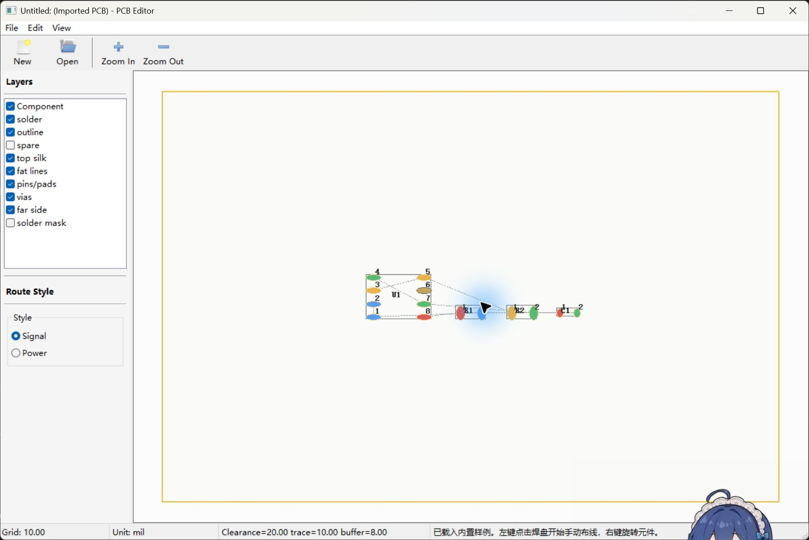
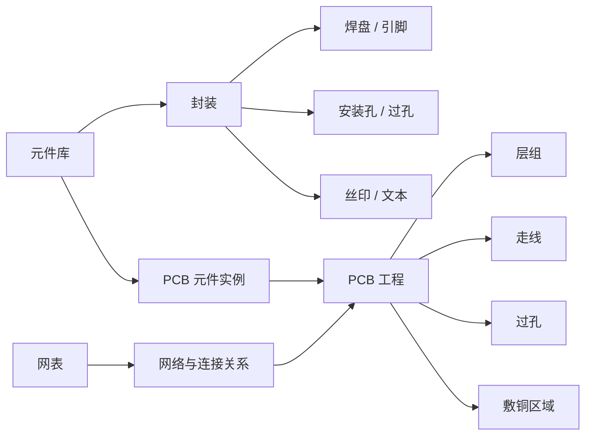

# PCB EDA 实验项目

> 电子科技大学信息与软件工程学院  
> EDA 软件设计 I 实验课程项目

本项目围绕印制电路板（PCB）的基础设计流程，完成一个具备图形界面、面向对象数据模型、文件持久化和基础电气连接能力的 PCB EDA 软件。项目分为两个递进实验：

1. **实验一：电路板元件封装的设计与管理**，实现封装编辑器、元件库管理器和封装文件读写。
2. **实验二：印制电路板的绘制与电气连接**，复用实验一的元件库，实现 PCB 编辑器、层组管理、网表导入、元件布局、布线和敷铜。

项目当前已具备可运行的 wxWidgets PCB 界面、网表导入、引脚匹配、自动布局、手动与自动布线、过孔、敷铜避让、连接检查及工程保存/载入能力。



## 快速运行

当前机器使用 Visual Studio 2026；安装 Visual Studio 2022 的环境可使用对应的 `vs2022-*` 预设。

```powershell
cmake --preset vs2026-x64
cmake --build --preset vs2026-debug
.\build\vs2026-x64\Debug\eda_gui.exe
```

在 Visual Studio 中打开仓库根目录，配置选择 `vs2026-debug`，启动目标选择 `eda_gui.exe`，按 `F5` 或 `Ctrl+F5` 运行。

程序顶部“样例”菜单提供 5 个可直接体验的工程：

- 导入与布局
- 手动布线与过孔
- 自动布线
- 完整敷铜与验证
- 核心模型演示

说明见 [样例目录](samples/README.md)。

无界面完整流程演示：

```powershell
.\build\vs2026-x64\Debug\pcbdemo.exe
```

测试：

```powershell
ctest --preset vs2026-debug
```

## 1. 项目目标

最终需要交付一个可运行、可演示、可保存和重新载入工程文件的桌面 EDA 程序，而不仅是计算机绘图演示。

项目必须建立在统一的面向对象数据模型上，体现 PCB 软件中的以下核心关系：

- 封装是焊盘、引脚或过孔、丝印、文本等对象的聚合。
- 元件库由可复用的封装组成，PCB 中的元件实例引用元件库中的封装。
- PCB 工程由板框、层组、元件实例、网络、走线、过孔和敷铜等对象组成。
- 图形显示、鼠标交互、电气连接和文件保存操作同一份数据，不能各自维护互相矛盾的数据。
- 焊盘尺寸、孔径、间距、线宽等属性必须进入数据模型并能够持久化，不能只作为屏幕上的像素。

## 2. 项目范围

### 2.1 必须实现

| 模块 | 主要能力 |
| --- | --- |
| 图形界面 | 主窗口、工具区、属性区、绘图区和基本状态提示 |
| 基础绘图 | 线段、弧线、矩形、多边形、圆、文本等图元 |
| 封装编辑器 | 创建、编辑、复制和删除封装；辅助网格与对齐 |
| 元件库 | 新建、重命名、查询、预览、保存和载入封装 |
| PCB 编辑器 | 板框、放置元件、选择、移动、旋转和删除 |
| 层组管理 | 层列表、活动层、层可见性和层颜色 |
| 网表与连接 | 导入网表、显示元件引脚所属网络、建立电气连接 |
| 布局 | 手动摆放和基础自动布局 |
| 布线 | 手动布线和基础自动布线 |
| 过孔与敷铜 | 放置过孔；创建、显示和编辑敷铜区域 |
| 文件读写 | 保存和载入封装库、PCB 工程及必要的外部网表 |
| 验证与测试 | 核心模型测试、文件往返测试和完整演示工程 |

### 2.2 第一阶段暂不追求

- 可直接用于生产的完整设计规则检查（DRC）。
- 与商业 EDA 软件完全兼容的全套封装格式。
- 多层高速信号、阻抗、信号完整性或电源完整性仿真。
- 工业级自动布线器、三维装配检查和制造文件全流程。
- 在线多人协作或云端项目管理。

以上能力可以在基础功能稳定后作为扩展项，不应影响两个实验最低交付要求的完成。

### 2.3 技术基线

| 项目 | 选择 |
| --- | --- |
| 平台 | Windows 10/11 x64 |
| 语言 | C++17 |
| IDE 与编译器 | Visual Studio 2022 / MSVC v143 x64 |
| GUI | wxWidgets 3.2.2 |
| 绘图 | wxWidgets 双缓冲画布 |
| 构建 | CMake + Visual Studio 17 2022 generator |
| 模型坐标 | `double` 毫米；文件导入时由微米转换为毫米 |
| 工程文件 | 带版本号的 JSON 文本格式 |

本机已安装的 wxWidgets 库使用 MSVC 构建，所有成员统一使用 x64 MSVC 工具链，不混用 MinGW。

## 3. 两个实验的任务内容

### 3.1 实验一：电路板元件封装的设计与管理

目标是设计面向对象数据模型，并实现一个封装编辑器和一个元件库管理器。

#### 任务 A：理解并建立封装模型

- 阅读若干典型元件规格，将尺寸、引脚编号、焊盘位置、孔径和丝印轮廓整理成结构化数据。
- 建立封装对象，使其能够聚合焊盘、引脚、安装孔、丝印和文本。
- 为焊盘记录形状、尺寸、钻孔尺寸、所在层、阻焊开窗及必要的间距属性。
- 为引脚记录编号、功能名称、电气类型以及与焊盘的关联关系。
- 为丝印和文本记录几何数据、线宽、字体大小和所在层。
- 明确长度、坐标、角度和层号使用的单位，避免界面、模型和文件格式之间单位不一致。

#### 任务 B：实现基础绘图和编辑能力

- 选择 Windows 或 Linux 平台，以及一种图形界面开发方式。
- 选择绘图引擎，完成线段、弧线、矩形、多边形、圆和文本的绘制。
- 支持颜色、线宽、填充、坐标、尺寸和层次等外观属性。
- 提供网格显示、栅格吸附和基本对齐功能。
- 实现对象选择、框选、移动、缩放或尺寸编辑、旋转、复制和删除。
- 属性修改后必须立即反映在画布中，并正确更新底层对象。

#### 任务 C：实现封装编辑器

- 新建封装并填写封装名称、类别、描述和默认单位。
- 提供焊盘、引脚或过孔、丝印和文本等工具。
- 在画布上放置并编辑这些对象，支持按网格和参考点定位。
- 显示焊盘编号、引脚编号和丝印，避免关键标识重叠或不可见。
- 支持多选、批量移动、对齐和简单复制复用。
- 在保存前检查空名称、重复引脚编号、无效尺寸和缺少焊盘等基础错误。
- 保存后能够重新打开，所有几何、属性和层次关系保持一致。

#### 任务 D：实现元件库管理

- 支持新建、打开、保存和另存元件库。
- 支持按名称、类别或关键字查询封装。
- 在列表中显示封装名称和摘要，在预览区显示缩略图。
- 支持重命名、复制、删除封装，并在存在引用时给出提示。
- 对封装名称和标识建立唯一性规则，避免库内冲突。
- 准备至少一组示例封装，覆盖不同焊盘形状、引脚数量和丝印样式。

### 3.2 实验二：印制电路板的绘制与电气连接

目标是在实验一的基础上设计 PCB 数据模型，开发支持元件拖动、层组管理、布局和布线的 PCB 编辑器。

#### 任务 E：建立 PCB 工程模型

- 定义板框大小和坐标系，所有元件、走线和敷铜均限制在有效板框内。
- 支持创建、命名、排序、显示和隐藏多个图层，并维护层与层组的对应关系。
- PCB 中的元件实例引用封装库，记录位号、位置、旋转角度、所在面和锁定状态。
- 定义网络、元件引脚、走线段、拐点、过孔和敷铜区域之间的数据关系。
- 区分用于显示的图元数据与用于电气检查的网络数据，并保证二者同步。

#### 任务 F：实现层组与画布显示

- 提供层列表、活动层切换、显示开关和颜色设置。
- 允许用户只显示当前工作需要的层，但隐藏图层不能删除其数据。
- 切换活动层后，新绘制的走线、过孔和图元应写入正确图层或层组。
- 支持画布缩放、平移、网格吸附和元件拖放。
- 完成至少一种底层图形表示，能够清楚区分板框、焊盘、丝印、走线和敷铜。

#### 任务 G：导入元件与网表

- 从实验一生成的元件库中查找和放置封装。
- 为同一封装创建多个元件实例，并分别设置唯一位号和位置。
- 导入简单网表，并在导入前检查文件格式。
- 将网表中每个元件和引脚匹配到 PCB 中实际的元件实例和焊盘。
- 对未找到封装、未知元件、未知引脚、重复位号或无法匹配的网络给出明确错误。
- 导入成功后以飞线或网络高亮方式显示尚未完成的电气连接。

#### 任务 H：实现元件布局

- 支持单选和多选元件。
- 支持拖动、吸附、旋转、翻面和删除元件。
- 移动元件时同步移动其引脚、焊盘、丝印和网络连接端点。
- 提供基础自动布局功能，至少完成元件包围盒不重叠、尽量位于板框内、按网表连接关系的简单排列。
- 自动布局结束后仍允许手工调整，并能够撤销该次操作。
- 对超出板框或与其他元件明显重叠的放置结果给出提示。

#### 任务 I：实现手动布线

- 支持从焊盘或引脚开始依次绘制多段走线。
- 支持设置线宽、当前层和常用转角方式。
- 走线端点应吸附到焊盘中心或已有连接的合法位置。
- 支持移动、删除和重新连接走线段。
- 布线时显示当前网络信息，并禁止把一条走线直接连接到不属于该网络的对象。
- 在板框外、穿入禁止区域或与同层对象明显冲突时给出提示。
- 支持放置过孔并完成跨层连接。

#### 任务 J：实现基础自动布线和敷铜

- 对只包含少量元件和简单网络的示例，提供基础自动布线。
- 自动布线可以采用直线、直角或 45 度折线，以及最小生成树等简单策略。
- 当无法完成连接时，程序应保留已生成的合法走线并明确提示未连接网络，不能静默失败。
- 自动生成的走线必须转换为与手动布线相同的可编辑数据对象。
- 支持在板框内创建敷铜区域，并在敷铜与焊盘、走线之间保留间距。
- 敷铜区域能够显示、选择、编辑和保存，并随所属层一起控制可见性。

#### 任务 K：工程保存与重新打开

- PCB 工程至少保存板框、层组、元件实例、元件位置、网络、走线、过孔和敷铜。
- 文件包含格式版本和单位信息，为后续兼容升级保留空间。
- 保存和打开过程不得依赖程序当前界面的临时状态。
- 重新打开工程后，元件、连接关系、层属性和图形显示应与保存前一致。
- 对损坏文件、旧版本文件和不支持的格式给出可理解的错误信息。

## 4. 数据对象关系



开发时需要避免两种常见错误：

- 把封装编辑器写成脱离元件的普通画图程序。
- 把 PCB 编辑器写成只移动图片的界面，而元件、焊盘、网络和走线之间没有真实的数据关系。

## 5. 三人分工

下表使用“成员 A、成员 B、成员 C”作为占位，确认姓名后直接替换。分工按照模块完整性和依赖关系划分，不要求三个成员负责的任务数量完全相等。

| 成员 | 定位 | 主责任务 | 主要职责与交付物 |
| --- | --- | --- | --- |
| 成员 A | 核心架构与持久化 | A、E、K | 统一封装和 PCB 数据模型；设计文件格式；实现封装库与 PCB 工程的保存和载入；维护公共接口；编写模型与文件往返测试；负责技术集成 |
| 成员 B | 图形界面与编辑交互 | B、C、D、F | 主窗口、通用画布、绘图工具、属性面板；封装编辑器；元件库管理器；层列表、活动层和画布显示；负责界面联调和操作演示 |
| 成员 C | PCB 业务与算法 | G、H、I、J | 网表导入、元件与引脚匹配；元件拖动、旋转和基础自动布局；手动及基础自动布线；过孔、敷铜和基础避让；提供 PCB 样例并验证电气连接 |

成员 A 负责的底层任务数量较少，但公共模型和持久化会影响全部模块，实际工作量与其他成员基本平衡。不能在实验一结束后才建立 PCB 模型，否则 B、C 容易在临时对象或界面数据上重复实现。

### 5.1 模块边界

- 成员 A 定义层、层组及其保存方式；成员 B 实现层列表、可见性、颜色和画布显示；成员 C 在布线时使用当前活动层。
- 成员 B 提供通用画布、鼠标事件、撤销或重做等交互框架；成员 C 实现“从焊盘开始布线、生成走线、判断网络”等 PCB 业务。
- 成员 A 负责文件保存和载入；成员 B、C 不各自实现第二套文件格式，而是通过公共模型提交需要持久化的数据。
- 同一封装不能分别维护“界面版本”和“模型版本”；图形显示、鼠标编辑、网络连接及文件读写必须操作同一份核心数据。
- 每个人负责自己模块的单元测试，其他成员进行交叉检查。测试不能集中由某一名成员承担。
- 修改公共模型接口时，成员 A 必须通知 B、C；修改通用画布接口时，成员 B 必须通知 A、C 并完成联合验证。

### 5.2 分工时序

| 阶段 | 成员 A | 成员 B | 成员 C | 联合产物 |
| --- | --- | --- | --- | --- |
| 第 1 周 | 定义公共模型和文件格式，发布首批接口 | 搭建主窗口和通用画布 | 调研网表格式、准备样例并评审 PCB 模型 | 平台、接口和样例约定 |
| 第 2 周 | 完成封装库持久化、模型测试，建立 PCB 工程模型 | 完成封装编辑器、通用编辑工具和元件库界面 | 使用 PCB 模型完成网表解析和引脚匹配 | 实验一可运行版本和 PCB 基础模型 |
| 第 3 周 | 完成 PCB 工程持久化并支持联调 | 完成层管理、元件拖放及界面集成 | 完成布局、布线、过孔、基础自动布线和敷铜 | 实验二主要功能 |
| 第 4 周 | 文件兼容性、异常输入和整体集成 | 修复交互问题，完成操作演示 | 验证连接、避让及完整 PCB 演示流程 | 最终程序、测试记录和报告 |

实验一验收通过、公共模型和文件格式稳定后，再集中推进实验二。任一阶段出现接口变更时，应先更新接口和测试，再继续开发依赖该接口的功能。

## 6. 开发步骤

| 阶段 | 主责 | 工作内容 | 主要产物 | 完成条件 |
| --- | --- | --- | --- | --- |
| 0. 准备 | 全体 | 确认平台、语言、GUI 库和绘图引擎；建立代码规范与协作方式 | 技术决策记录、可运行空窗口、仓库分支约定 | 所有成员能够编译并启动程序 |
| 1. 核心模型 | 成员 A | 定义封装、焊盘、引脚、库、板框、层、元件实例、网络、走线、过孔和敷铜 | 独立于界面的数据结构和基础单元测试 | 可以创建、修改和遍历完整对象树 |
| 2. 图形基础 | 成员 B | 完成坐标变换、网格、图元绘制、命中测试和选择 | 可缩放的通用画布 | 图元可绘制、选择、移动和删除 |
| 3. 封装编辑 | 成员 B | 实现封装工具、属性编辑、验证和编辑操作 | 封装编辑器 | 能完成一个带焊盘、引脚、丝印和文本的封装 |
| 4. 元件库 | 成员 B | 实现封装组织、查询、预览、增删改，并通过 A 的文件接口持久化 | 元件库管理器与示例库 | 封装保存后重新载入保持一致 |
| 5. 实验一验收 | 全体 | 联调界面、模型和文件格式，修复数据不一致 | 可演示的封装设计程序、实验一记录 | 满足第 8 节实验一验收清单 |
| 6. PCB 基础 | 成员 A、B | A 建立板框、层组和元件实例模型；B 完成 PCB 画布、拖放和层显示 | 可放置、移动和保存元件的 PCB 编辑器 | 元件位置和层属性可以持久化 |
| 7. 网络连接 | 成员 C | 实现网表导入、引脚匹配、飞线和网络高亮 | PCB 网络模型 | 正确显示连接关系及错误原因 |
| 8. 布局布线 | 成员 C | 完成手动布局、基础自动布局、手动布线、过孔和基础自动布线 | 可生成并编辑走线的 PCB 编辑器 | 简单样例能够完成全部网络连接 |
| 9. 敷铜与检查 | 成员 C | 实现敷铜区域、避让和基础合法性提示 | 敷铜与检查功能 | 敷铜随层显示、保存和编辑 |
| 10. 集成验收 | 全体 | 执行文件往返、异常输入和完整流程测试；编写报告 | 示例工程、测试记录、演示脚本、实验报告 | 满足第 8 节实验二验收清单 |

开发应按照阶段顺序推进。实验一的封装模型和文件格式稳定后，再开始实验二的 PCB 工程，避免两套模型重复实现或互相转换困难。

## 7. 协作与提交要求

- 三人按第 5 节的主责任务推进；姓名确认后更新分工表，不临时重复实现同一模块。
- 每人只在自己的实验报告中填写本人实际完成的部分，不复制他人的工作总结。
- 鼓励使用 AI 辅助学习和开发，但需要保留提示词、生成结果、人工修改和验证过程等使用记录。
- 每次提交应说明完成了哪个任务、修改了哪些文件，以及如何验证。
- 核心模型、文件格式和界面交互应有相应测试或演示步骤，不能只附截图。
- 合并代码前至少完成一次干净环境构建，并确认示例工程可以打开和保存。
- 成员 A 负责公共接口和最终技术集成，成员 B 负责界面操作体验，成员 C 负责 PCB 样例和布线结果的可信性；三人在验收前共同走查完整演示流程。

## 8. 验收清单

### 8.1 实验一

- [ ] 主窗口包含工具区、绘图区、属性区和状态或操作提示。
- [ ] 可以新建并命名一个封装。
- [ ] 封装至少包含一个焊盘、一个带编号的引脚、一段丝印和一段文本。
- [ ] 焊盘形状、尺寸、孔径、所在层和间距等属性可编辑。
- [ ] 图元支持网格吸附、选择、移动、编辑和删除。
- [ ] 封装可以保存到元件库，并能够重新打开。
- [ ] 元件库支持创建、查询、预览、重命名、复制和删除。
- [ ] 保存前后对象数量、位置、属性和层次关系一致。
- [ ] 至少提供一组可复用的示例封装。

### 8.2 实验二

- [x] 可以从 PCB 元件库中选择并放置至少两个元件实例。
- [x] 元件可以拖动、吸附、旋转，并保留正确的封装和网络关系。
- [ ] 可以创建、命名、显示、隐藏和切换多个图层或层组。
- [x] 可以导入简单网表，并正确报告无法匹配的元件、引脚或网络。
- [x] 可以执行基础自动布局。
- [x] 可以手动绘制多段走线，并编辑线宽、当前层和连接端点。
- [x] 可以放置过孔并建立跨层连接。
- [x] 简单样例可以使用基础自动布线完成连接；失败时给出提示。
- [x] 可以创建并显示敷铜区域，基础避让设置有效。
- [x] PCB 工程保存并重新打开后，元件、网络、走线、过孔、层和敷铜保持一致。
- [x] 提供一套从导入网表到保存工程的完整演示流程。

## 9. 实验安排

根据课程材料，实验安排为：

- 时间：第 9-12 周，星期一第 7-10 节。
- 地点：二教 206。

若课程通知有调整，以教师或助教的最新通知为准。

## 10. 设计资料与后续文档

设计资料：

- [网表格式设计](docs/netlist-format.md)：字段、匹配规则、导入流程和错误码。
- [PCB 模型评审](docs/pcb-model-review.md)：核心对象、单位、不变量和模块边界。
- [Visual Studio 2022 开发约定](docs/vs2022-setup.md)：固定工具链、目标和验证顺序。
- [基础网表样例](examples/netlist-basic/README.md)：SOIC-8、电阻、电容和四个网络的完整样例。
- [网表 JSON Schema](schemas/netlist.schema.json)。
- [封装库 JSON Schema](schemas/footprint-library.schema.json)。
- [PCB 工程 JSON Schema](schemas/board.schema.json)。
- [成员 C 使用与验收说明](docs/member-c-guide.md)。

C++ 样例校验程序位于 `tools/validate_design.cpp`。使用 CMake 构建后运行 `validate_design`，可检查样例中的元件、封装、引脚、网络和 PCB 工程引用是否一致。

当前机器使用：

```powershell
cmake --preset vs2026-x64
cmake --build --preset vs2026-debug
ctest --preset vs2026-debug
```

安装 Visual Studio 2022 的环境可改用 `vs2022-x64`、`vs2022-debug`。

后续仍可继续补充：

- 界面操作手册。
- 封装编辑器和完整元件库管理界面。
- 更完整的布局约束、DRC 和自动布线算法。
- 成员姓名与最终分工确认、AI 使用记录和实验报告。
